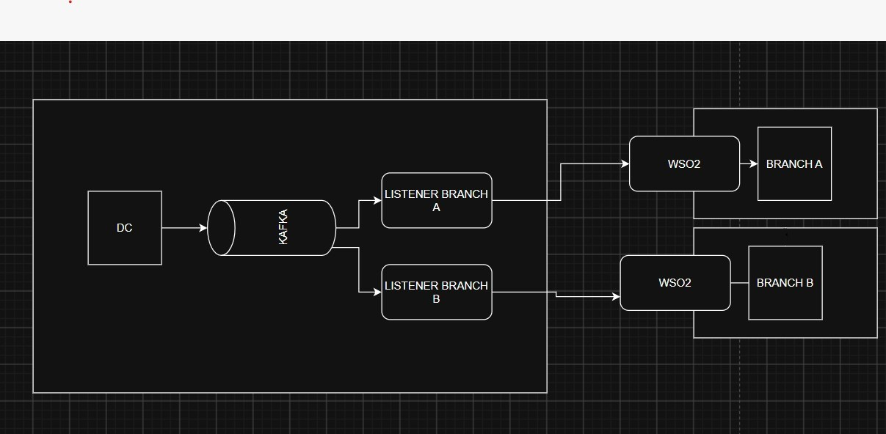
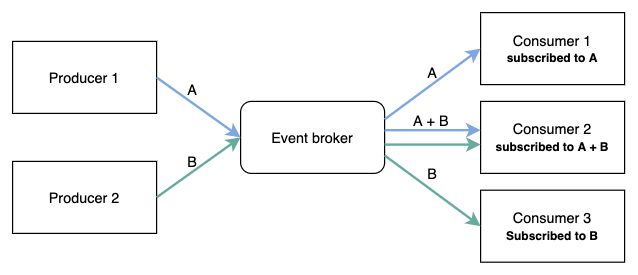

# Architecture chart

Saved from the planning discussion (2026-10-14). See also [CLAUDE.md](../CLAUDE.md).

## Notes

- Same service, different location
- Publisher: manage API control
- Developer Portal: used by developers
- Event-Driven Architecture (EDA) concept
- WSO2 for each branch, with pub/sub (*"wso2 tiap branch ada pubsub"*)

## Agreed chart (one-way flow)

```text
┌──────────────────────── DC environment ─────────────────────────────┐      ┌──── Branch A environment ────┐
│                                                                      │      │                              │
│  DC service                     topic dc.branch-A ┌───────────────┐ │      │ ┌──────────┐    ┌──────────┐ │
│  GET  /data   (all branches)   ┌─────────────────►│ Listener A    │─┼──────┼►│ WSO2     │───►│ Branch A │ │
│  POST /sync/{branch}           │                  └───────────────┘ │      │ │ gateway  │    │ GET /data│ │
│  POST /purge/{branch}          │                                    │      │ └──────────┘    │ (A only) │ │
│        │                       │                                    │      │                 └──────────┘ │
│        ▼                ┌──────┴──────┐                             │      └──────────────────────────────┘
│  DC database  ─────────►│    Kafka    │                             │      ┌──── Branch B environment ────┐
│  (all data)     publish └──────┬──────┘                             │      │                              │
│                                │  topic dc.branch-B ┌─────────────┐ │      │ ┌──────────┐    ┌──────────┐ │
│                                └───────────────────►│ Listener B  │─┼──────┼►│ WSO2     │───►│ Branch B │ │
│                                                     └─────────────┘ │      │ │ gateway  │    │ GET /data│ │
│                                                                      │      │ └──────────┘    │ (B only) │ │
└──────────────────────────────────────────────────────────────────────┘      │                 └──────────┘ │
                                                                               └──────────────────────────────┘
         One-way flow: DC ──► Kafka ──► Listener (in DC env) ──► WSO2 (in branch env) ──► Branch.  Branches never call the DC.
```

## Original sketches

The user's drawing of the target architecture:



The EDA concept the design is based on (producers → event broker → subscribed consumers):


